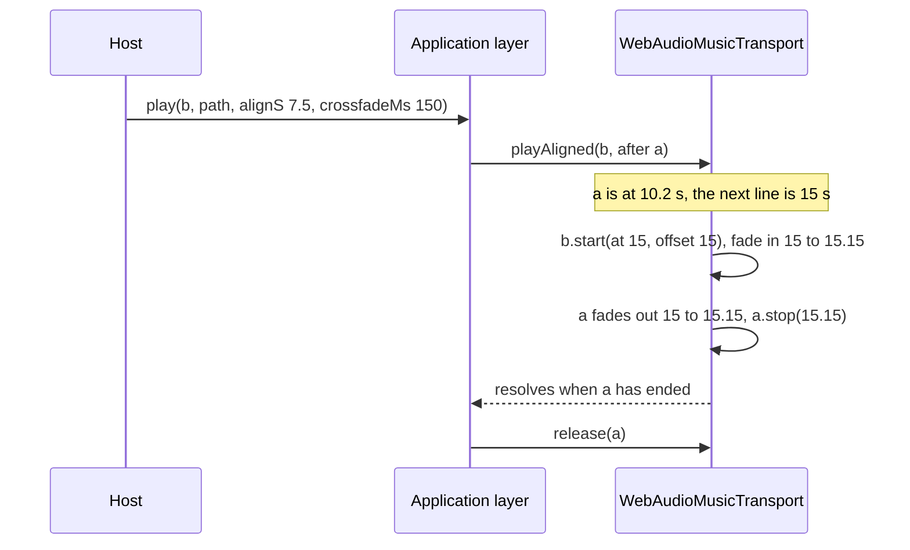

# Music playback

**Rule.** Music is decoded once and read from a buffer in a circle. The engine does not hand a
looping track to the platform's media player, and an implementation of `MusicTransport` must not
request compressed audio offload.

A host application plays the same music in a circle for minutes at a time. That single requirement
is what separates this case from media playback, and it is where a platform player fails in three
independent ways. All three were measured on devices; each is stated here with the measurement,
because a rule without one gets reverted by the next reader who has a good reason.

## A platform player has a seam at the loop point

Measured on a Pixel 9 Pro against the same build on a Galaxy A25.

| track length | audible event | what is heard |
| --- | --- | --- |
| 21.8 s | every 22 s | frequent scratches |
| 91 s | every 91 s | sporadic scratches |
| two tracks overlapping | two decoder starts | the worst case |
| ~48 s under a dense cue load | every 48 s | present, but covered by the cues |

One mechanism explains the whole table, and the platform log names it — one event per cycle of the
track:

```text
c2.android.aac.decoder#385:1D-Output: received null buffer
MediaCodec: keep callback message for
CCodecConfig: query failed after returning
```

The queue moves from one item to the next and the AAC decoder reconfigures. This is the model of a
queue-based player, not one of its settings, and no option removes it.

### What it was not

Three hypotheses each held for a few hours and fell. They are recorded because they are the ones the
next reader will have:

- **not load**: zero mixer underruns across a full session, and no frame gaps above 60 ms during the
  transitions that scratched the most;
- **not the sum of the cues**: the densest passage, with tens of cues per second, is the cleanest
  place of all;
- **not the buffer**: raising it from 250 ms to 1 s reduced the worst symptom without removing it,
  because a large buffer covers a stall, not a decoder discontinuity.

A system feature — Adaptive Sound on Pixel devices — amplified everything, which is why the same
build sounded different on two phones. With the artifact removed it has nothing left to amplify, and
the build is clean with that feature switched on.

## A platform player's loop is not gapless

Android's `MediaPlayer` ignores the MP4 edit list, so every turn of a 48 s loop gains 32-42 ms of
encoder priming: a hiccup once per loop. It is measurable without a device, by decoding the file
with `ffmpeg -ignore_editlist 1` and comparing the result with the honest decode.

A Web Audio buffer source is sample-exact by construction. `MusicTransport` therefore carries a
`gaplessLoop` flag: a transport that cannot loop cleanly must say so instead of being trusted.

## Compressed audio offload renders some streams with a rasp

On Android the offload path decodes AAC on a coprocessor to save power. On at least one shipping
device family it renders a plain 44.1 kHz AAC stream with an audible rasp — measured 2026-09-07 on a
Pixel 9 Pro against a Galaxy A25 with the same build and the same bit-identical file, by switching
transports at runtime inside one running application, three times.

The file was innocent: peaks 6-9 dB below full scale, zero mixer underruns, bytes in the installed
package matching the source. In Media3 offload is opt-in, so the requirement costs nothing — but it
has to be stated, or it gets enabled later for the battery win and reopens this.

## What the decision costs

Decoding once and reading from a buffer is not free, and the price is stated so a host can weigh it:

- **+4.2 points of one core and +4.3% current**, paired ABBA comparison, n=2;
- **18-35 MB of RAM per decoded track**, one track at a time.

"One track at a time" holds only if a stopped track really gives its memory back, and on iOS 26 it
did not.

## A stopped source must give its buffer back

**Rule.** When a transport stops a source, it sets the source's buffer to `null` before it
disconnects it (`releaseStoppedSource`).

WebKit on iOS 26 never finishes an `AudioBufferSourceNode` that is stopped and disconnected in the
same turn. The node stays alive for the life of the page, and so does the buffer it points at: for
music, the whole decoded track. A host that changes track at every screen leaked one decoded track
per change, and the web content process was killed after a quarter of an hour of play.

Measured on an iPhone 13 with iOS 26, 2026-09-22, in a host application: one looping AAC track
decoded to 17.6 MB, played for 0.2 s and stopped, eighty times in a row.

| how the source is stopped | outcome |
| --- | --- |
| `stop()`, then `disconnect()` at once | process killed after 60, 65 and 71 decodes, three runs |
| decoded and never played | all eighty, in 2.5 s |
| `stop()`, buffer set to `null`, then `disconnect()` | all eighty |
| `stop()`, `disconnect()` deferred to `onended` | all eighty |

One-shot cues already disconnect on `onended`, and held voices now drop their buffer too.

## Changing track on the beat

**Rule.** A change between two tracks that share a tempo is placed by the transport, on the audio
clock, at a line of the beat grid, and the incoming track starts from the position the outgoing one
has reached. `music.play(id, path, { alignS, crossfadeMs })` asks for it; `MusicTransport.playAligned`
does it.

A host with several tracks written over the same accompaniment — one per area of a game, the same
chord cycle and tempo, a different melody on top — wants the change between them not to be heard.
Two things make it heard, and only the second one is the transport's to fix:

- the instrument that carries the melody changes, which no timing hides;
- the change lands off the beat, and the incoming track starts from its top while the outgoing one
  is in the middle of a bar. Today's crossfade starts the moment it is asked for, which is wherever
  the host's frame happened to be.

So the change waits. The engine hands it to the transport whole, because only the transport owns the
clock the music runs on: a start placed from the application layer would land wherever the main
thread was when it ran, which is precisely what alignment exists to avoid. The Web Audio transport
schedules everything in one turn on `AudioContext.currentTime`:



- **The line.** The position of the outgoing track is the time since its start, plus the offset it
  started from, modulo its duration. The change happens at the next instant that position crosses a
  multiple of `alignS`; the loop seam counts as a line too, so a track whose length is not a
  multiple of the grid still changes on a downbeat. A line less than 50 ms away is skipped for the
  next one, because a start placed that close can be in the past by the time the graph reads it,
  and Web Audio would then start it late at the requested offset, off the beat by the delay.
- **The position.** The incoming track starts at that instant from the outgoing track's position,
  modulo its own duration. Two tracks of the same length and tempo therefore stay on the beat.
- **The fades.** They run on a gain of their own, between the source and the level gain, so a duck or
  a level change during the wait or the fade moves the level without undoing the change. With
  `crossfadeMs: 0` it is a cut on the line.
- **How long the fade should be: short.** Heard on 2026-11-09 with the four chapter tracks of a host
  application (45 s, 128 BPM, one chord cycle every 7.5 s, the same tempo and chords, a different
  melody and voice each), changing on the line with three fades. At 2 s the change was heard as a
  change: «Si sente la dissolvenza, non sembra continuo». At 150 ms it was heard as one piece that
  goes on; a cut on the line was the third option and was not chosen. The measurement explains it.
  Tracks written over the same accompaniment are still not the same signal sample by sample: the
  correlation between the four, over their whole length, was 0.02-0.24. A linear fade between
  signals that unrelated sums to about -2.7 dB at its midpoint (-2.06 to -2.90 dB across the six
  pairs), and for its whole length two arrangements play at once. The line is where the melodies'
  phrases end, so a short fade there hides the change and a long one exposes it. An equal-power
  curve would remove the dip but not the overlap, so the engine keeps the linear ramp and the length
  is the host's choice.
- **Suspension.** The clock that measures the position is the context's, which stands still while
  the context is suspended. A change asked for before a suspension happens at the same musical
  point after the resume.

What a host sees meanwhile: `status().playing` names the incoming track at once; the outgoing one
stays audible until the line, up to `alignS` seconds later, and `play` resolves when its fade has
finished. `music.stop()` silences both, a duck reaches both, and an ordinary change made during the
wait fades both out. A second change on the beat asked for before the first one's line takes its
place at the same line; asking for the outgoing track again before its line makes the change
inaudible, because the new voice enters on the line at the position the old one is fading out from.

The cost is the one the rest of this page counts in memory: from the request to the end of the fade
two decoded tracks are held, not one.

`playAligned` is optional in the port. A transport that cannot place a start on its own clock leaves
it out, and the engine falls back to the ordinary crossfade; an implementation that started the
track "about now" would claim an alignment it does not deliver. A grid that is not a finite positive
number is ignored, and with nothing playing the track starts at once from zero.

## When a host should still bring its own transport

The reasoning above is about content that loops. A host that plays content which *ends* — a stinger,
a scene, a spoken chapter — does not meet the condition that makes a platform player fail, and gains
what a platform player offers: background playback, a media notification, lock-screen controls, and
hardware decoding for long files.

That host injects its own implementation through the `musicTransport` option of
`createAudioEngine()`. The port is public for exactly this reason, and the rules above become its
acceptance criteria: declare `gaplessLoop` honestly, do not request compressed audio offload, and
implement `playAligned` only if the platform can start a track at a given instant from a given
position.
